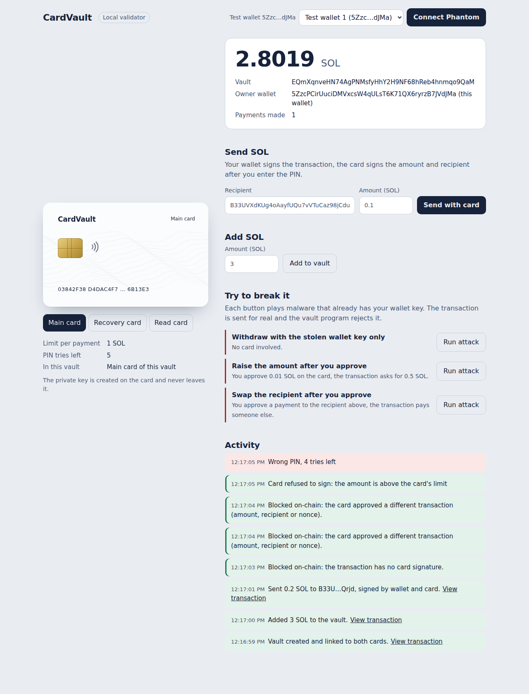

# CardVault: a Java Card co-signer for Solana

**Problem.** Browser-extension wallets (Phantom, MetaMask) keep the private key on the
computer. Malware that reads it can drain the wallet, and a lost seed phrase means lost funds.

**Idea.** Funds live in an on-chain vault that needs **two** signatures:

1. the owner's normal Solana key (Phantom, Ed25519), and
2. a **P-256 signature from a physical NFC/contact Java Card**, made only after a PIN,
   and only if the amount is within a limit **enforced by the card itself**.

A second card is the **recovery card**: if the Phantom key is stolen or lost, it can move the
vault to a new owner key. No seed phrase involved.

> "Even if malware steals your Phantom key, your funds can't move without the physical card,
> and the card enforces its own spending rules."



Demo video: [`docs/cardvault-demo.mp4`](docs/cardvault-demo.mp4)

## How it works

```
 Phantom key (Ed25519) ──signs tx──┐
                                   ▼
 Card (P-256) ──signs message──► [ secp256r1 precompile ix ][ card_vault::withdraw ix ]
   PIN + limit checked ON CARD          verifies signature       checks: right card key,
                                                                 right message, nonce, owner
```

The card never signs Solana transactions directly (they must be Ed25519). It signs an
81-byte **authorization message**, which Solana's native secp256r1 precompile (SIMD-0075)
verifies; the program then checks that the precompile verified *this vault's card* and
*exactly this withdrawal*.

**Signed message (81 bytes):**

| bytes | field |
|---|---|
| 0 | tag: `01` withdraw, `02` recover |
| 1..33 | vault address |
| 33..65 | recipient (withdraw) / new owner (recover) |
| 65..73 | amount, u64 little-endian, lamports (must be 0 for recover) |
| 73..81 | vault nonce, u64 little-endian (anti-replay) |

## Repository

| folder | what |
|---|---|
| `applet/` | Java Card applet (P-256 key on card, PIN, on-card limit). Prebuilt `build/cardvault.cap` (Java Card 3.0.4, works on JCOP3 and JCOP4) |
| `sim/` | jCardSim tests (22 checks) and a TCP card simulator so the client works with no physical card |
| `program/` | Anchor program `card_vault` (vault, withdraw, recover) |
| `client/` | TypeScript CLI, offline self-test, on-chain attack tests |
| `client/src/bridge.ts` + `client/web/` | **web app**: local bridge (card + transactions) serving the UI on http://localhost:8787; Phantom signs in the browser |
| `scripts/demo-local.sh` | one command: local validator + 2 simulated cards + full CLI demo + attacks |
| `scripts/web-local.sh` | one command: local validator + 2 simulated cards + web app with 2 test wallets |
| `SUBMISSION.md` | Demo Day pitch script, judge Q&A, paste-ready Colosseum / Superteam Earn texts, pitch video script |
| `docs/cardvault-demo.mp4` | captioned 1:35 demo video of the web app (local validator, simulated cards) |
| `scripts/record/record.py` | Playwright script that recorded the demo video (needs the stack from `web-local.sh`) |

## Tested

Everything below was run against a local `solana-test-validator` (Agave 4.3, secp256r1
precompile active) with two simulated cards:

- normal withdrawal (owner key + card + PIN) succeeds
- withdrawal above the card limit: the **card** refuses to sign
- recovery card moves the vault to a new owner; the old (stolen) key can no longer withdraw
- **attacks blocked on-chain** (`npm run attacks`): stolen owner key with no card;
  card approved 0.1 SOL but tx asks 0.5; recipient swapped; signature from another card;
  replay of an old signature; corrupted signature

---

## Web app

```
 Browser (http://localhost:8787)          bridge (Node, localhost only)          Solana
 Phantom connect + sign  <──────────────>  builds txs, talks to the card  ──────>  card_vault
                                           PC/SC reader or simulator
```

Browsers can't talk to smart-card readers, so a small local **bridge** does that and builds
the transactions; **Phantom signs in the browser**, the bridge submits and turns program
errors into plain sentences. The bridge listens on 127.0.0.1 only and rejects requests from
other websites (Origin check).

Screens: create vault (read recovery card, then main card), balance, send with card + PIN,
add SOL, **Try to break it** (three malware attacks sent for real and rejected on-chain),
recovery to a new wallet, activity log with explorer links.

```bash
# rehearse locally: validator + 2 simulated cards + 2 test wallets (no Phantom needed)
./scripts/web-local.sh            # then open http://localhost:8787

# real cards + Phantom on devnet (after deploying, see section 3)
cd client
CARD_VAULT_PROGRAM_ID=<id> npm run bridge
# one reader: the page tells you when to swap main and recovery card
```

Phantom: turn on Testnet mode (Settings, Developer settings) and fund the wallet from
https://faucet.solana.com. Bridge env: `MAIN_CARD`, `RECOVERY_CARD` (`pcsc` or `sim:<port>`),
`RPC_URL`, `CARD_VAULT_PROGRAM_ID`, `PORT`, `DEV_WALLETS` (comma-separated keypair files
shown as test wallets, for rehearsals only).

## 1. Run everything in the simulator (no cards needed)

Prerequisites: JDK 17, Maven, Node 20+, Solana CLI, Anchor 0.31.

```bash
# card simulator (builds jCardSim from source)
./sim/setup.sh
./sim/run.sh test                 # 22 applet checks

# program
cd program && anchor build && cd ..

# client
cd client && npm install && cd ..

# full demo: validator + 2 simulated cards + all scenarios + attacks
./scripts/demo-local.sh

# or the web app with the same setup
./scripts/web-local.sh
```

Manual use: start cards with `./sim/run.sh 9025` (main) and `./sim/run.sh 9026` (recovery),
then `CARD=sim:9025 npm run cli -- pubkey` etc. Simulated PIN is `1234`.
A simulated card keeps the same key across restarts (seeded by its port number).

## 2. Real cards (J3H081)

> ⚠️ **Read before touching the cards.** These cards ship transport-locked. Wrong transport
> key or Card Manager key attempts decrement a counter, and the card can be **locked
> permanently**. Try each step **once**; if the response is not `9000`, stop and ask the seller.
>
> Use the transport key and Card Manager keys from the seller's note for your cards (keep them
> private, they are not in this repo). Check them carefully: an AES key is exactly 32 hex
> characters, and a typo costs one of the limited attempts.

Use **one card first**; flash the second only after the first works.

```bash
# PC/SC: Linux needs pcscd + libpcsclite-dev; Windows/macOS have it built in.
# GlobalPlatformPro: https://github.com/martinpaljak/GlobalPlatformPro (gp.jar)

# 1) unlock transport key (exactly as in the seller's note, once)
java -jar gp.jar -d --apdu 00F0000010<TRANSPORT_KEY_32_HEX>

# 2) check the card (default keys 4041..4F)
java -jar gp.jar -i               # chip info: confirm JCOP3 vs JCOP4
java -jar gp.jar -l               # list applets

# 3) install the applet
java -jar gp.jar --install applet/build/cardvault.cap
java -jar gp.jar -l               # should show A000000BEEF00101

# 4) use it (default PIN 1234 - change it!)
cd client
npm run cli -- pubkey
npm run cli -- change-pin
npm run cli -- set-limit 0.5
```

Rebuilding the CAP: put `ant-javacard.jar` in `applet/`, clone
`https://github.com/martinpaljak/oracle_javacard_sdks` as `applet/sdks`, then
`JAVA_HOME=<JDK 17> ant` in `applet/`.

## 3. Devnet

```bash
cd program
anchor keys sync                  # writes your own program id into lib.rs and Anchor.toml
anchor build && anchor deploy --provider.cluster devnet   # needs ~1.5-3 devnet SOL
export CARD_VAULT_PROGRAM_ID=<id from anchor keys list>

cd ../client
npm run cli -- pubkey             # with the RECOVERY card in the reader -> copy hex
npm run cli -- init <recovery-hex># with the MAIN card in the reader
npm run cli -- deposit 1
npm run cli -- withdraw <recipient> 0.2
npm run cli -- recover <new-owner-pubkey> <original-creator-pubkey>   # recovery card
npm run cli -- info
```

The owner key is `~/.config/solana/id.json` (or `OWNER_KEYPAIR=`); it stands in for Phantom.

## CLI reference

| command | needs |
|---|---|
| `pubkey` | card: prints compressed public key, limit, PIN tries |
| `init <recovery-pubkey-hex>` | owner key + main card |
| `deposit <SOL>` | owner key |
| `withdraw <recipient> <SOL>` | owner key + main card + PIN |
| `recover <new-owner> [creator]` | recovery card + PIN (any wallet pays the fee) |
| `info [creator]` | nothing |
| `set-limit <SOL>`, `change-pin` | card + PIN |

Env: `CARD=pcsc` (default) or `CARD=sim:<port>`, `RPC_URL`, `OWNER_KEYPAIR`,
`PAYER_KEYPAIR`, `CARD_VAULT_PROGRAM_ID`.

## Card APDUs (CLA 0x80, AID A000000BEEF00101)

| INS | command | data | response |
|---|---|---|---|
| 10 | GET_PUBKEY | - | 65-byte uncompressed point |
| 20 | VERIFY_PIN | PIN | `9000` / `63Cx` (x tries left) / `6983` blocked |
| 30 | SIGN | 81-byte message | DER ECDSA-SHA256; `6982` no PIN, `6985` over limit, `6A80` bad recover, `6A81` bad tag |
| 40 | SET_LIMIT | u64 LE lamports | needs PIN |
| 50 | CHANGE_PIN | 4-8 bytes | needs PIN |
| 60 | GET_INFO | - | limit (8, LE) + PIN tries (1) |

PIN: 5 tries, then blocked. Every signature consumes the PIN (must be entered again).

## Known limits (say these honestly in the pitch)

- **No screen on the card.** Malware can show you one thing and send the card another.
  Mitigation today: the card itself enforces a per-transaction limit, so damage is capped.
  Next: show the transaction on a second device (phone over NFC) or a whitelist on card.
- **Limit is per transaction.** The card has no clock, so a daily limit must live on-chain
  (good next feature for the program).
- **The recovery card alone can change the owner.** Keep it somewhere safe; a time-lock on
  recovery would be a good addition.
- Keys cannot be exported or backed up, by design: the recovery card is the backup.
- jCardSim generates the same key on every simulated card; `SimServer` re-seeds per port.
  Real cards use their hardware RNG.
- Hackathon prototype, not audited.

## Status and what's left

Done and tested (simulator + local validator + headless browser): applet, program, CLI,
bridge, web app, attack scenarios, recovery.

Left for the team:

1. Flash the real cards (section 2) and run the web app with a reader.
2. Deploy to devnet and test once with real Phantom (the browser flow was tested with
   test wallets; Phantom uses the same transactions).
3. Record the demo video (max 3 min) and pitch video (max 2 min), see `SUBMISSION.md`.
4. Submit on Colosseum and on Superteam Earn (SolanaCZE track); opt in to the Accretion
   security track; register the Demo Day pitch.
5. Nice to have: on-chain daily limit, recovery time-lock, Android NFC app (same APDUs over IsoDep).
